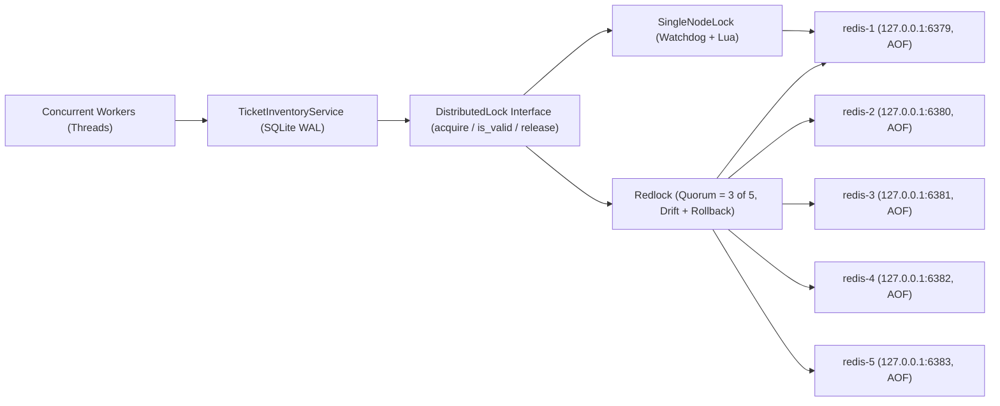
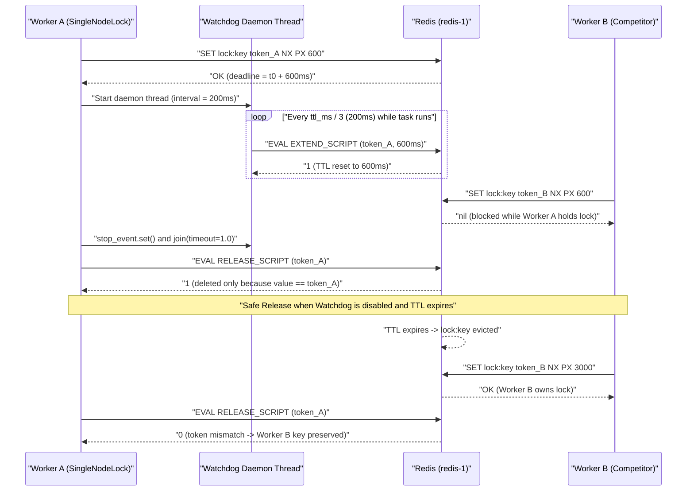
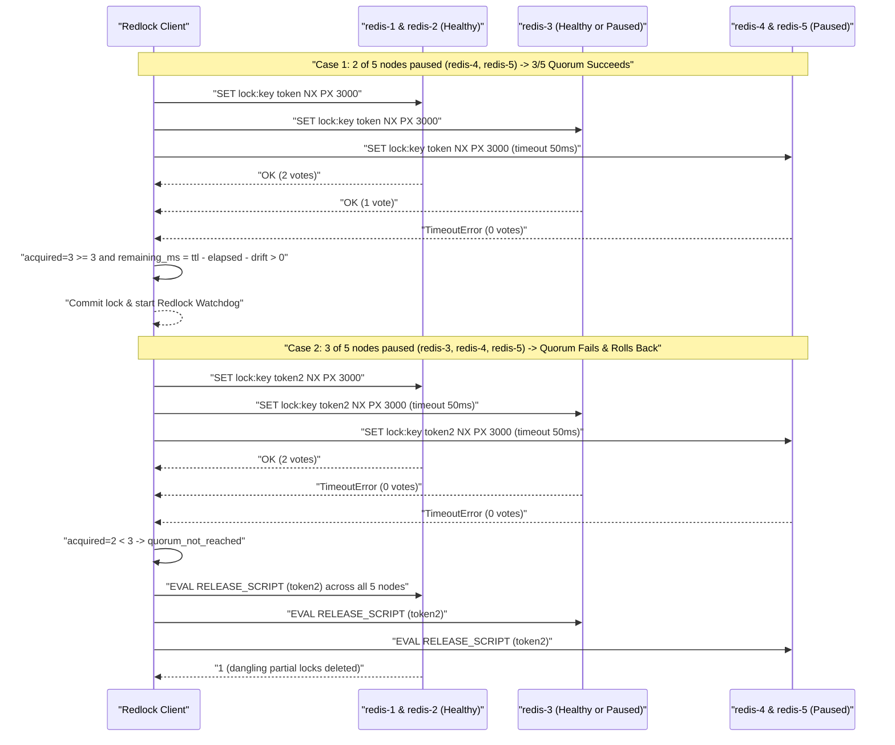

# Redis Distributed Lock & Ticket Inventory Demo

A clean, runnable Python 3.12+ reference implementation of Redis-based distributed concurrency control on a single developer machine (macOS / Apple Silicon via Docker Compose and `uv`).

It pairs two `DistributedLock` implementations—a **single-node lock with Watchdog auto-renewal** and a **5-master Redlock quorum manager**—with a minimal SQLite WAL `TicketInventoryService` consumer and an automated chaos `pytest` suite that proves correctness under contention, long-running critical sections, expired-worker races, and Docker container pauses.

---

## Table of Contents

- [Architecture & Design](#architecture--design)
  - [Why 5 Independent Redis Masters Instead of Redis Cluster?](#why-5-independent-redis-masters-instead-of-redis-cluster)
  - [Core Components](#core-components)
- [Architecture & Protocol Diagrams](#architecture--protocol-diagrams)
  - [System Topology](#system-topology)
  - [Watchdog Renewal & Owner-Safe Lua Release](#watchdog-renewal--owner-safe-lua-release)
  - [Redlock Quorum Acquisition & Rollback](#redlock-quorum-acquisition--rollback)
- [Repository Layout](#repository-layout)
- [Quickstart (macOS / Apple Silicon)](#quickstart-macos--apple-silicon)
  - [Inspecting Structured Concurrency Logs](#inspecting-structured-concurrency-logs)
- [Code Usage](#code-usage)
  - [Single-Node Lock (`SingleNodeLock`)](#single-node-lock-singlenodelock)
  - [5-Node Quorum Lock (`Redlock`)](#5-node-quorum-lock-redlock)
  - [Protecting `TicketInventoryService`](#protecting-ticketinventoryservice)
- [Chaos & Concurrency Test Suites](#chaos--concurrency-test-suites)
- [Production Caveats & Limitations](#production-caveats--limitations)

---

## Architecture & Design

### Why 5 Independent Redis Masters Instead of Redis Cluster?

Redlock requires $N$ **completely independent** Redis master instances (`redis-1` through `redis-5` in `docker-compose.yml`, running `redis:7-alpine` with `--appendonly yes` on `127.0.0.1:6379`–`6383`) with zero replication and zero `--cluster-enabled` slot sharding:

1. **No async replication race:** In a primary-replica topology (including Redis Cluster shards with replicas), replication is asynchronous. If a primary acknowledges `SET key token NX PX` and crashes before replicating to its replica, the promoted replica has no record of the lock and can grant the same key to a second client—breaking mutual exclusion.
2. **No single-shard bottleneck:** Redis Cluster hashes a given key to one hash slot on one master. Running 5 independent masters lets the client fan out `SET NX PX` in parallel and require a majority quorum ($\lfloor 5/2 \rfloor + 1 = 3$) so the lock survives up to 2 unavailable nodes.

### Core Components

- **Unified Lock Interface (`src/redis_lock_demo/interfaces.py`)**:
  - `DistributedLock` (ABC) defines `key`, `acquire()`, `release()`, `extend(ttl_ms=None)`, `is_valid()`, and context manager methods (`__enter__` raises `LockAcquisitionError` on failure; `__exit__` calls `release()`).
  - Custom exceptions: `LockAcquisitionError` and `LockLostError`.
- **Atomic Lua Scripts (`src/redis_lock_demo/lua_scripts.py`)**:
  - `RELEASE_SCRIPT`: Atomically checks `redis.call("get", KEYS[1]) == ARGV[1]` before calling `DEL`, returning `0` if the key expired or belongs to another owner.
  - `EXTEND_SCRIPT`: Atomically checks `redis.call("get", KEYS[1]) == ARGV[1]` before calling `PEXPIRE`, returning `0` if ownership was lost.
- **Single-Node Lock + Watchdog (`src/redis_lock_demo/single_node.py`)**:
  - Acquires via `SET <key> <uuid4_token> NX PX <ttl_ms>` with configurable `retry_count` and jittered `retry_delay_ms` (`0.5x`–`1.5x`).
  - When `enable_watchdog=True`, spawns a daemon `threading.Thread` (`watchdog-<key>`) driven by a `threading.Event` stop flag. Every `ttl_ms / 3` ms, it executes `EXTEND_SCRIPT` with `max(ttl_ms, ceil(remaining_ms))` so longer manual extensions are never shrunk. If extension fails or errors, it sets `is_valid()` to `False` and exits.
- **Redlock Quorum Manager (`src/redis_lock_demo/redlock.py`)**:
  - `create_redlock_clients()` creates 5 `redis.Redis` clients configured with `socket_timeout=0.05`, `socket_connect_timeout=0.05`, and `Retry(NoBackoff(), 0)` so paused or partitioned nodes fail fast.
  - `Redlock` fans out `SET NX PX` across all $N$ nodes via `ThreadPoolExecutor(max_workers=N)`, deducts clock drift (`drift_ms = int(ttl_ms * 0.01) + 2`), and succeeds only if `acquired_count >= quorum` (`3`) and `remaining_ms = ttl_ms - elapsed_ms - drift_ms > 0`.
  - On partial acquisition failure, it immediately runs `RELEASE_SCRIPT` across **all** $N$ nodes to prevent dangling locks on surviving masters, then retries with jitter.
  - When `enable_watchdog=True`, its daemon thread (`redlock-watchdog-<key>`) renews across all $N$ nodes every `ttl_ms / 3` ms and requires quorum renewal (`>= 3` nodes within drift-adjusted TTL) to keep `is_valid()` `True`.
- **Thin SQLite WAL Consumer (`src/redis_lock_demo/ticket_inventory.py`)**:
  - `TicketInventoryService` manages `events` and `bookings` tables in SQLite WAL mode (`PRAGMA journal_mode=WAL;`, `PRAGMA busy_timeout = 30000;`).
  - `book_seat(event_id, user_id, lock_factory=..., processing_delay_s=0.1)` acquires `lock:event:<event_id>`, reads inventory, simulates downstream work (`processing_delay_s`), verifies `lock.is_valid()` before committing the decrement/insert (raising `LockLostError` if renewal failed), and releases in `finally`. Passing `lock_factory=None` runs unprotected to demonstrate check-then-act overselling.
- **Structured Concurrency Logging (`src/redis_lock_demo/_logging.py`)**:
  - `log_lock_event()` emits thread-safe `key=value` log lines containing `event`, `worker_id`, `resource`, `owner_token` (safe 8-char UUID prefix), `quorum_count`, and `elapsed_ms`.

---

## Architecture & Protocol Diagrams

### System Topology



### Watchdog Renewal & Owner-Safe Lua Release



### Redlock Quorum Acquisition & Rollback



---

## Repository Layout

```text
redis-distributed-lock-demo/
├── AGENTS.md                         # Multi-agent orchestration & review protocol
├── SPEC.md                           # Technical specification & acceptance criteria
├── README.md                         # Project documentation (this file)
├── docker-compose.yml                # 5 standalone redis:7-alpine masters (ports 6379-6383)
├── pyproject.toml                    # uv project config (Python >=3.12, redis>=5.2.0, pytest)
├── docs/
│   └── blog/
│       ├── medium-article.md         # Companion technical narrative (Step 7b)
│       └── linkedin-post.md          # Companion short-form post (Step 7b)
├── .agents/
│   ├── agents/                       # Specialized role prompts
│   └── skills/                       # Project skills (redis-concurrency-patterns, uv-pytest-docker-workflow)
├── src/
│   └── redis_lock_demo/
│       ├── __init__.py               # Public package exports
│       ├── _logging.py               # Thread-safe structured key=value concurrency logging
│       ├── interfaces.py             # DistributedLock ABC, LockAcquisitionError, LockLostError
│       ├── lua_scripts.py            # Atomic RELEASE_SCRIPT and EXTEND_SCRIPT
│       ├── single_node.py            # SingleNodeLock + Watchdog daemon thread
│       ├── redlock.py                # 5-node Redlock quorum manager + Watchdog + client factory
│       └── ticket_inventory.py       # Thin SQLite WAL TicketInventoryService consumer
└── tests/
    ├── conftest.py                   # Redis fixtures, lock cleanup, Docker pause/unpause fixture
    ├── test_race_condition.py        # Unprotected oversell vs. SingleNodeLock & Redlock
    ├── test_watchdog.py              # 3x TTL task survival with Watchdog auto-renewal
    ├── test_safe_release.py          # Expired worker cannot delete new owner's lock
    └── test_redlock_quorum.py        # 2/5 paused succeeds (3/5 quorum); 3/5 paused rolls back
```

---

## Quickstart (macOS / Apple Silicon)

### Prerequisites

- **Docker Desktop** (or OrbStack / Colima) with `docker compose`
- **[`uv`](https://docs.astral.sh/uv/)** Python package manager
- **Python 3.12+**

### Setup & Run Tests

```bash
# 1. Start the 5 independent Redis master containers (ports 6379-6383)
docker compose up -d
docker compose ps

# 2. Create the virtual environment and install dependencies via uv
uv sync

# 3. Run the chaos & concurrency test suite
uv run pytest -v
```

> **Note:** `tests/conftest.py` includes a session-scoped `ensure_redis_cluster_ready` fixture that automatically unpauses any leftover paused containers, starts `docker compose up -d` if any node on `6379`–`6383` is unreachable, and cleans up `lock:*` keys between tests. The `pause_containers` fixture always unpauses containers in `finally`.

To tear down the Redis containers when finished:

```bash
docker compose down
```

### Inspecting Structured Concurrency Logs

Enable pytest's live CLI logging to observe lock acquisition, Watchdog renewals, quorum rollbacks, and SQLite booking outcomes in real time:

```bash
uv run pytest -v -s --log-cli-level=INFO
```

Use `--log-cli-level=DEBUG` to also inspect per-node socket errors during Docker pauses and jittered retries. Sample structured log lines emitted by `log_lock_event`:

```text
INFO     redis_lock_demo.redlock:redlock.py:281 event=redlock_acquired worker_id=ThreadPoolExecutor-0_0 resource=lock:event:concert-1 owner_token=3f8a1c90 quorum_count=3 elapsed_ms=4.82 attempt=1 attempt_elapsed_ms=4.71 remaining_ms=2963.29 quorum_required=3 total_nodes=5 ttl_ms=3000 watchdog=True
WARNING  redis_lock_demo.redlock:redlock.py:325 event=redlock_quorum_rollback worker_id=MainThread resource=lock:event:test-quorum-lost owner_token=a914b20e quorum_count=2 elapsed_ms=52.14 attempt=1 quorum_required=3 total_nodes=5 rolled_back_count=2 remaining_ms=2915.86 reason=quorum_not_reached
INFO     redis_lock_demo.ticket_inventory:ticket_inventory.py:86 event=booking_confirmed worker_id=user-0@ThreadPoolExecutor-0_0 resource=lock:event:concert-1 owner_token=3f8a1c90 quorum_count=- elapsed_ms=106.42 lock_mode=Redlock quorum_required=3
```

---

## Code Usage

Public symbols exported by `redis_lock_demo`: `SingleNodeLock`, `Redlock`, `create_redlock_clients`, `TicketInventoryService`, `DistributedLock`, `LockAcquisitionError`, `LockLostError`, `RELEASE_SCRIPT`, `EXTEND_SCRIPT`, `DEFAULT_REDIS_PORTS`, and `DEFAULT_SOCKET_TIMEOUT_S`.

### Single-Node Lock (`SingleNodeLock`)

```python
import redis
from redis_lock_demo import LockAcquisitionError, SingleNodeLock

client = redis.Redis(host="127.0.0.1", port=6379, socket_timeout=0.5)

try:
    with SingleNodeLock(
        client,
        key="lock:order:42",
        ttl_ms=3000,
        retry_count=15,
        retry_delay_ms=100,
        enable_watchdog=True,
    ) as lock:
        # Critical section — Watchdog extends TTL every 1000ms (ttl_ms / 3)
        if lock.is_valid():
            print("Processing order 42 safely...")
except LockAcquisitionError:
    print("Could not acquire lock")
```

### 5-Node Quorum Lock (`Redlock`)

```python
from redis_lock_demo import LockAcquisitionError, Redlock, create_redlock_clients

# Connects to 127.0.0.1:6379..6383 with socket_timeout=0.05 and Retry(NoBackoff(), 0)
clients = create_redlock_clients()

try:
    with Redlock(
        clients,
        key="lock:settlement:batch-99",
        ttl_ms=3000,
        retry_count=15,
        retry_delay_ms=100,
        enable_watchdog=True,
    ) as lock:
        if lock.is_valid():
            print(f"Acquired quorum ({lock.quorum}/{len(clients)})")
except LockAcquisitionError:
    print("Quorum unavailable; partial locks were rolled back")
finally:
    for client in clients:
        client.close()
```

> **Tip:** Passing `clients=None` to `Redlock(None, key=...)` creates and manages internal clients automatically; call `lock.close()` when done to close the internal connection pools.

### Protecting `TicketInventoryService`

```python
from concurrent.futures import ThreadPoolExecutor
from redis_lock_demo import Redlock, TicketInventoryService, create_redlock_clients

service = TicketInventoryService("tickets.db")
service.create_event("show-2026", total_seats=5)
clients = create_redlock_clients()

def book(user_idx: int) -> bool:
    return service.book_seat(
        "show-2026",
        f"user-{user_idx}",
        lock_factory=lambda resource: Redlock(
            clients,
            resource,
            ttl_ms=3000,
            retry_count=50,
            retry_delay_ms=100,
            enable_watchdog=True,
        ),
        processing_delay_s=0.1,
    )

with ThreadPoolExecutor(max_workers=15) as pool:
    results = list(pool.map(book, range(15)))

print("Booked:", sum(results))                           # 5
print("Remaining:", service.get_available_seats("show-2026"))  # 0

for client in clients:
    client.close()
```

---

## Chaos & Concurrency Test Suites

Running `uv run pytest -v` executes 4 test suites (9 tests total, passing in ~10s against the 5 Docker Compose Redis containers):

| Suite | Tests | Scenario & Verified Outcome |
| :--- | :---: | :--- |
| [`tests/test_race_condition.py`](tests/test_race_condition.py) | 3 | **15 concurrent workers** compete for **5 seats** (`processing_delay_s=0.1`). **Unprotected (`lock_factory=None`)** oversells (`available_seats < 0` and `len(bookings) > 5`, hitting `-10` available when all 15 workers read `5` before writing). Both **`SingleNodeLock`** and **5-node `Redlock`** serialize access to book **exact 5/5 seats** (`available_seats == 0`, 10 workers return `False`, 0 keys left). |
| [`tests/test_watchdog.py`](tests/test_watchdog.py) | 2 | Acquires `SingleNodeLock` and `Redlock` with `ttl_ms=600` and `enable_watchdog=True`, then sleeps **`1.8s` (`3x` initial TTL)**. `is_valid()` stays `True`, `pttl > 0` on Redis (and on `>= 3` nodes for Redlock), a competing worker fails to acquire mid-task, and release frees the lock cleanly. |
| [`tests/test_safe_release.py`](tests/test_safe_release.py) | 2 | Worker A acquires (`ttl_ms=300`, `enable_watchdog=False`) and sleeps `500ms` so its lock expires. Worker B acquires the same key with a new UUID token. Worker A calls `release()` -> Lua `RELEASE_SCRIPT` returns **`False`**, preserving Worker B's key intact on Redis (single-node and all 5 Redlock nodes). |
| [`tests/test_redlock_quorum.py`](tests/test_redlock_quorum.py) | 2 | Uses `docker pause` / `docker unpause`: **(1)** pausing `redis-4` and `redis-5` leaves **3/5 quorum** intact, allowing `Redlock.acquire()` and `TicketInventoryService.book_seat()` to succeed (`1` seat left of `2`); **(2)** pausing a 3rd node (`redis-3`, `redis-4`, `redis-5`) drops to 2/5, causing `acquire()` to return `False`, `book_seat()` to raise `LockAcquisitionError`, and leaving **0 dangling `lock:*` keys** on `redis-1` and `redis-2`. |

---

## Production Caveats & Limitations

1. **No Fencing Tokens (GC / Process Pauses):**
   This implementation uses lease-based locks with `is_valid()` pre-commit checks, not monotonically increasing **fencing tokens** enforced by the downstream storage engine (as highlighted in Martin Kleppmann's critique of Redlock). If a worker passes `lock.is_valid()` and then experiences a stop-the-world GC pause, VM freeze, or OS scheduling stall longer than the remaining TTL before committing to SQLite/Postgres, the lock can expire and be granted to another worker while the paused worker's commit still lands. Production systems needing strict correctness across arbitrary process pauses should pair locks with storage-level fencing (e.g., rejecting writes whose token is `<=` the last seen monotonic token) or optimistic concurrency control / database transactions.
2. **Clock Drift & Redis Persistence Semantics:**
   Redlock bounds local acquisition/renewal validity with `drift_ms = int(ttl_ms * 0.01) + 2` and `time.monotonic()`. However, `docker-compose.yml` starts Redis with `--appendonly yes` (default `appendfsync everysec`). In a real crash-restart scenario, up to ~1 second of AOF writes could be lost on disk if a master restarts immediately—which is why Redlock in production recommends delayed restarts (waiting at least `max_ttl` before bringing a crashed node back).
3. **Single-Machine Local Demo Scope:**
   All 5 Redis nodes bind to `127.0.0.1` on one host and `TicketInventoryService` writes to a local SQLite WAL file. Cross-AZ network partitions, TLS/auth (`REDIS_PASSWORD`), and multi-host clock skew are outside the scope of this reference repository.
